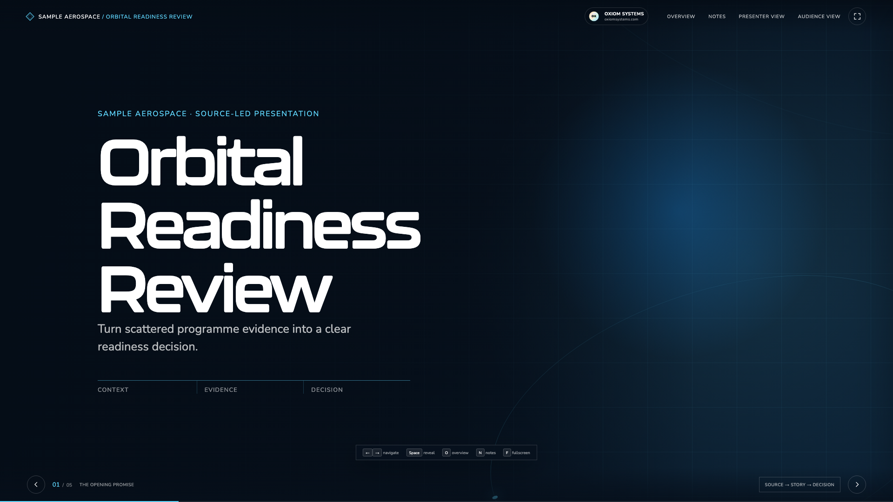

# Oxiom Presentations

A reusable Codex skill for building cinematic, evidence-led HTML5 presentations from source material.

It packages the presentation system developed across the NewSpace, CubeSpace, Dragonfly Aerospace, and Vanilla Tech work into one consistent source-to-deck workflow.



## What it creates

- a full-screen HTML5 audience deck;
- a synchronized presenter console with read-aloud narration;
- keyboard navigation, progressive reveals, overview, notes, and fullscreen;
- direct `file://` operation for offline presentations;
- print/PDF support and extension points for voiceover and narrated video;
- a source ledger, claim-authority rules, validation, and functional tests;
- five reusable visual archetypes built on the Oxiom editorial engineering system.

The skill keeps the presentation engine consistent while treating client identity, claims, imagery, dates, metrics, and delivery paths as project-specific content.

## Install with Codex

Ask Codex:

> Use `$skill-installer` to install `https://github.com/Oxiom-Systems/oxiom-presentations`.

Or install manually:

```bash
git clone https://github.com/Oxiom-Systems/oxiom-presentations \
  ~/.codex/skills/oxiom-presentations
```

Restart or open a new Codex task if the skill does not appear immediately.

## Use it

Tag the skill and provide your source material, audience, and intended outcome:

> Use `$oxiom-presentations` to turn these source materials into a 12-minute leadership presentation for the executive team. The presentation should explain the current evidence, the remaining readiness gap, and the decision required.

The skill can coordinate an agency-style build when you explicitly request delegation or parallel agents.

## Scaffold directly

The skill includes a dependency-free starter generator:

```bash
node scripts/scaffold.mjs \
  --output /absolute/path/to/new-presentation \
  --title "Readiness Review" \
  --client "Example Organisation" \
  --subtitle "Turn programme evidence into a clear readiness decision."
```

Then verify the generated presentation:

```bash
npm test --prefix /absolute/path/to/new-presentation
npm run validate --prefix /absolute/path/to/new-presentation
```

## Repository structure

```text
.
|-- SKILL.md
|-- agents/openai.yaml
|-- assets/starter/
|-- references/
|   |-- design-system.md
|   |-- extension-patterns.md
|   |-- qa-and-delivery.md
|   `-- source-to-deck.md
`-- scripts/
    |-- scaffold.mjs
    `-- validate-deck.mjs
```

## Design and evidence principles

- One narrative job and one primary claim per slide.
- Large editorial typography, dark ink and bright paper surfaces, and cyan evidence lines.
- A source ledger plus a `[Sources]` block in every slide's hidden speaker notes.
- Tentative targets, estimates, proposals, and illustrative concepts stay visibly qualified.
- Oxiom is the stable maker signature; client identity remains replaceable.
- Public examples contain no client-confidential source material or client-owned media.

## Contributing

Issues and pull requests are welcome. Keep the shared engine client-neutral, preserve source authority, and run a clean scaffold smoke test before submitting changes.

## License

MIT License. See [LICENSE](LICENSE).
